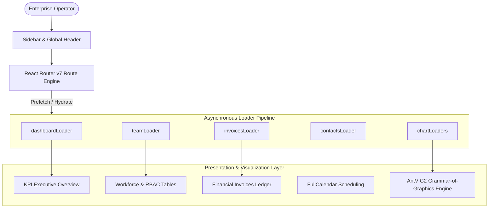

# Enterprise Admin Dashboard — Operations Intelligence & Analytics Console

[](https://react.dev/)
[](https://reactrouter.com/)
[](https://ant.design/)
[](https://g2.antv.antgroup.com/)
[](https://vitejs.dev/)
[](LICENSE)

An enterprise-grade administrative management and business intelligence dashboard. Built with **React 19**, **React Router v7**, **Ant Design 5**, and the **AntV G2 Grammar of Graphics**, the platform delivers real-time operational monitoring, multi-tier workforce directory management, financial invoicing ledgers, and advanced statistical data visualizations.

---

## Architecture Overview

The system utilizes an asynchronous route loader pattern powered by **React Router v7**, decoupling data resolution from component rendering to guarantee zero layout shifts across deep views:



---

## Core Capabilities

### 1. Executive Operations & KPI Hub
- Real-time aggregation of commercial throughput, active workforce allocations, client account transactions, and pending operational tasks.
- Card metrics featuring directional variance indicators (positive gains vs cautionary declines).

### 2. Workforce Directory & Access Control (RBAC)
- Multi-column data grid with inline status badges, role badges (`Admin`, `Manager`, `User`), contact details, and age distributions.
- Direct account provisioning via validated submission forms (`form.jsx`).

### 3. Financial Invoicing & Transaction Records
- Paginated accounts-receivable ledger detailing client identifiers, invoice identifiers, billing values, and transaction timestamps.

### 4. Advanced Analytics Powered by AntV G2
The visualization engine uses the declarative grammar of graphics (`@antv/g2`) for high-density statistical reporting:
- **Multi-Dimension Bar Chart (`barChart.jsx`):** Comparative commodity frequencies cross-referenced against country origins with interactive hover tooltips and dynamic legend toggles.
- **Temporal Line Trend (`lineChart.jsx`):** Multi-series timeline tracking metric trajectories across quarterly operational cycles.
- **Proportional Pie / Donut Breakdown (`pieChart.jsx`):** Segment share representation with sector highlighting.
- **Geographic Density Distribution:** Geospatial coordinate projection mapping client concentrations across international territories.

### 5. Event Scheduling & Knowledge Base
- Interactive calendar scheduler (`calendar.jsx`) for conference calls, stakeholder meetings, and deadlines.
- Collapsible Accordion FAQ (`faq.jsx`) indexing enterprise standard operating procedures and compliance rules.

---

## Repository Structure

```
entreprise-admin-dashboard/
├── tests/
│   └── admin_data_and_loaders.test.js  # Automated data model & analytics tests
├── front/
│   ├── .env.example
│   ├── package.json
│   ├── vite.config.js
│   └── src/
│       ├── App.jsx                     # Root router & theme provider
│       ├── components/                 # Reusable AntV G2 chart components
│       │   ├── barChart.jsx
│       │   ├── lineChart.jsx
│       │   └── pieChart.jsx
│       ├── data/                       # Mock data generators & GeoJSON
│       │   ├── mockData.js
│       │   └── mockGeoFeatures.js
│       ├── Loaders/                    # Route-level prefetch loaders
│       │   ├── dashboardLoader.js
│       │   ├── teamLoader.js
│       │   ├── invoicesLoader.js
│       │   └── calendarLoader.js
│       └── pages/                      # Domain views (team, invoices, charts)
```

---

## Quickstart & Local Setup

### 1. Prerequisites
- Node.js 18+ (tested on Node v20/v22/v24)
- npm

### 2. Installation & Launch

```bash
# Clone the repository
git clone https://github.com/youcef-ach/entreprise-admin-dashboard.git
cd entreprise-admin-dashboard/front

# Install dependencies
npm install

# Setup environment configuration
cp .env.example .env

# Run automated tests
npm test

# Start Vite development server
npm run dev
```

Open `http://localhost:5173` to view the administrative console.

### 3. Production Build

```bash
npm run build
npm run preview
```

---

## Automated Test Suite

The test suite validates data schemas, role distribution math, financial aggregation accuracy, and AntV series formatting:

```bash
npm test
```
```
▶ Enterprise Admin Dashboard - Data Models & Analytics Pipelines
  ✔ Team roster enforces valid role permissions and unique identifiers
  ✔ Workforce role distribution aggregates administrative ratios accurately
  ✔ Financial invoice pipeline parses currency strings to numeric totals
  ✔ AntV G2 chart series contains compliant category tags and positive frequencies
✔ Enterprise Admin Dashboard - Data Models & Analytics Pipelines
ℹ tests 4
ℹ pass 4
ℹ fail 0
```

---

## License

This project is licensed under the MIT License — see the [LICENSE](LICENSE) file for details.
